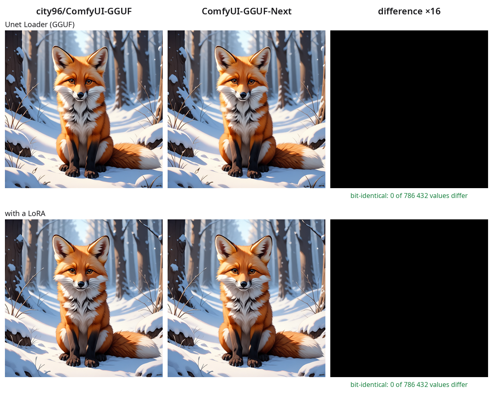

# ComfyUI-GGUF-Next

<div align="center">

[English](README.md) · **Русский** · [Docs](docs/en/README.md) · [Документация](docs/README.md)

<br>

[](https://zrn59.me)
[](https://www.donationalerts.com/r/zrn59)

*Custom Bot & Web Development • Data Parsing • Isolated Docker Hosting — **[zrn59.me](https://zrn59.me)***

</div>

---

<p align="center">
  <br>
  Anima Q4_K_M, один воркфлоу и один сид. Слева city96/ComfyUI-GGUF, посередине GGUF-Next, справа разница: 0 отличающихся значений.
</p>

Узлы загрузки GGUF для ComfyUI. Это форк [city96/ComfyUI-GGUF](https://github.com/city96/ComfyUI-GGUF), который понимает больше типов квантов, диффузионных моделей и текстовых энкодеров. ID узлов, входы и категория те же, поэтому старые воркфлоу открываются без изменений. Все 35 типов хранения ggml, из них 26 квантованных, обрабатываются в torch, на GPU.

| | city96/ComfyUI-GGUF | ComfyUI-GGUF-Next |
| --- | --- | --- |
| Типы хранения, обрабатываемые в torch | 15, из них 12 квантованных | 35 (все типы хранения ggml), из них 26 квантованных |
| IQ1/IQ2/IQ3, TQ (файлы Unsloth «UD») | numpy на CPU, каждый слой, каждый шаг | torch, бит-в-бит с gguf-py |
| Диффузионные архитектуры | белый список из 12 | всё, что распознаёт твоя ComfyUI |
| Текстовые энкодеры | T5, Llama, Qwen2.5-VL, Qwen3, Gemma 3 | + Gemma 2, Qwen2, Mistral 3, Qwen3-VL включая 32B, GGUF с раскладкой ComfyUI |
| Квантованные `scale_shift_table`, `modulation` | в вес копируются сырые блоки | деквантуются при загрузке |
| Conv1d, Conv3d, ConvTranspose, RMSNorm | не квантуются | квантуются |
| Поиск по эмбеддингу | вся таблица деквантуется на каждый вызов | только нужные строки |
| Модель больше свободной RAM | при первой загрузке копируется в RAM и уходит в своп | остаётся в mmap, читается из файла |
| Архитектуры `convert.py` / `lcpp.patch` | 11 | около 30 |

В сравнениях с оригиналом выход совпадает бит-в-бит: картинка Anima, с LoRA и без, и кодирование текста Qwen2.5-VL-7B. CLIPLoader (GGUF) даёт ту же картинку, что и штатный CLIPLoader.

## Проверено на реальных файлах

Каждый файл загружен шестью паками GGUF на одной ComfyUI: RTX 3050 Laptop 4 ГБ, 15 ГБ RAM.

| Файл | city96 | leejet | Nif00 | molbal | ChrisColeTech | GGUF-Next |
| --- | --- | --- | --- | --- | --- | --- |
| Anima turbo Q4_K_M | ✅ | ✅ | ✅ | ✅ картинка отличается от city96 | ✅ бит-в-бит с city96 | ✅ полная генерация, бит-в-бит с city96 |
| LTX-2.5 Distilled Q4_K_M | ✅ | ✅ | ✅ | ✅ | ✅ | ✅ полная генерация |
| MiniMax H3 Q4_K (sd.cpp, без метаданных) | ❌ неизвестная архитектура | ✅ | ❌ неизвестная архитектура | ✅ | ✅ | ✅ полная генерация |
| Qwen2.5-VL-7B Q4_K_M | ✅ | ✅ | ✅ | ✅ бит-в-бит с city96 | ❌ CUDA OOM | ✅ кодирование бит-в-бит с city96 |
| Gemma 4 12B Q5_K_M (энкодер LTX-2.5) | ❌ `gemma4` отклонён | ❌ `gemma4` отклонён | ❌ `KeyError` | ✅ то же кодирование, что у GGUF-Next | ❌ I16 не поддерживается | ✅ |
| Qwen3-VL-32B UD-Q2_K_XL (энкодер MiniMax H3) | ❌ `TypeError` | ❌ не те ключи | ❌ CUDA OOM | ❌ CUDA OOM | ❌ не те размеры слоёв | ✅ |

leejet — это [leejet/ComfyUI-GGUF](https://github.com/leejet/ComfyUI-GGUF), Nif00 — [Nif00/ComfyUI-GGUF](https://github.com/Nif00/ComfyUI-GGUF), molbal — [molbal/ComfyUI-GGUF](https://github.com/molbal/ComfyUI-GGUF) на `3ae2b68`, ChrisColeTech — [ChrisColeTech/ComfyUI-GGUF-Loader](https://github.com/ChrisColeTech/ComfyUI-GGUF-Loader) на `109a281`.

- CUDA OOM значит, что энкодер не поместился в эту карту на 4 ГБ. GGUF-Next кодирует те же файлы на ней.
- Картинка Anima у molbal отличается от city96, PSNR 25.9 дБ. С выключенным Triton-бэкендом картинка та же, так что разница не из него. На турбо-модели в 6 шагов даже мелкие различия округления дают такую разницу.
- ChrisColeTech импортирует OpenCV при запуске, а его не ставит ни его `requirements.txt`, ни ComfyUI. Без него не загружается весь пак. Для теста он был установлен.

Энкодер Gemma 4 от LTX-2.5 загружают только GGUF-Next и molbal, а энкодер Qwen3-VL-32B от MiniMax H3 на 4 ГБ запускает только GGUF-Next. В GGUF-Next обе модели проходят от промпта до кадров:

<p align="center">
  <br>
  LTX-2.5 Distilled Q4_K_M + Gemma 4 12B Q5_K_M. 1280×704, 97 кадров, двухстадийный воркфлоу из шаблона LTX-2.5 в ComfyUI. <a href="docs/ltx25.mp4">MP4 со звуком</a>
</p>

<p align="center">
  <br>
  MiniMax H3 Q4_K + Qwen3-VL-32B UD-Q2_K_XL. 960×544, 73 кадра, 20 шагов. <a href="docs/minimax-h3.mp4">MP4 со звуком</a>
</p>

Оба видео сгенерировал Claude (ИИ-агент Anthropic), пока тестировал пак: по одному сиду, без отбора и правок. Они показывают, что модели работают, а не лучшее, на что эти модели способны. Превью — 12 fps и 720 px в ширину, MP4 — полный выход в 24 fps. На 4 ГБ VRAM и 15 ГБ RAM трансформеры считались на GPU: LTX-2.5 — 25 минут, MiniMax H3 — 18. Текстовые энкодеры шли на CPU (`--novram`), потому что энкодер Gemma 4 в ComfyUI не помещается в 4 ГБ, см. [модели](docs/models.md#текстовые-энкодеры). Промпт у обеих: «A red fox walks through a snowy pine forest at sunrise, golden light between the trees, snowflakes drifting in the air, cinematic tracking shot. Snow crunches under its paws, a soft wind moves through the pines.»

## Установка

Нужна рабочая ComfyUI с Python 3.9 или новее. Сначала удали или отключи оригинальный ComfyUI-GGUF: оба пака регистрируют одинаковые имена узлов, и побеждает тот, что загрузился последним. Чтобы отключить оригинал, переименуй его папку в `ComfyUI-GGUF.disabled`. Если GGUF-Next найдёт вторую копию, он предупредит об этом при старте.

```bash
cd ComfyUI/custom_nodes
git clone https://github.com/Zrn59/ComfyUI-GGUF-Next
pip install -r ComfyUI-GGUF-Next/requirements.txt
```

Так ставится текущий `main`. Список изменений: [CHANGELOG.md](CHANGELOG.md).

В `requirements.txt` перечислены `gguf>=0.13.0`, `sentencepiece` и `protobuf`. Версии не закреплены. `torch`, `numpy` и `transformers` не указаны. Уже установленный пакет не обновляется и не откатывается. Для файлов MXFP4, NVFP4 и Q1_0 нужен `pip install -U gguf`.

### Windows portable

Запускать из папки, где лежит `run_nvidia_gpu.bat`:

```bat
git clone https://github.com/Zrn59/ComfyUI-GGUF-Next ComfyUI\custom_nodes\ComfyUI-GGUF-Next
.\python_embeded\python.exe -s -m pip install -r .\ComfyUI\custom_nodes\ComfyUI-GGUF-Next\requirements.txt
```

## Использование

Узлы лежат в категории `bootleg`, как в оригинале:

| Узел | Заменяет |
| --- | --- |
| Unet Loader (GGUF) | Load Diffusion Model |
| Unet Loader (GGUF/Advanced) | то же плюс `dequant_dtype`, `patch_dtype`, `patch_on_device`, `compile_dequant` |
| CLIPLoader (GGUF), Dual/Triple/QuadrupleCLIPLoader (GGUF) | стандартные загрузчики CLIP, для `.gguf` и `.safetensors` |

- Диффузионные модели кладутся в `models/unet` или `models/diffusion_models`. Текстовые энкодеры — в `models/text_encoders` или `models/clip`.
- Qwen2.5-VL и Qwen3-VL нужен их `mmproj-*.gguf` в той же папке. Загрузчик ищет его по имени файла без суффикса кванта. Единственный `mmproj` в папке берётся, только если тип его проектора подходит к энкодеру.
- `compile_dequant` (или `GGUF_COMPILE_DEQUANT=1`) компилирует ядра деквантования через `torch.compile`. Нужен `triton`. Первые шаги идут медленнее, пока идёт компиляция. Значения в fp16/bf16 округляются иначе, чем в обычном пути, и на каждом тензоре скомпилированный путь ближе к fp32. На моделях с малым числом шагов это меняет мелкие детали картинки, как и штатный узел TorchCompileModel ([сравнение](docs/quants.md#compile_dequant)). Работает вместе с узлом TorchCompileModel.
- LoRA работают со стандартными загрузчиками LoRA.
- Модель больше свободной RAM не копируется в RAM. Её веса остаются в mmap и читаются из файла. `GGUF_RELEASE_MMAP=1` копирует всегда, как оригинал. `GGUF_RELEASE_MMAP=0` не копирует никогда.

Список моделей, типы квантов и скорость: [docs/models.md](docs/models.md), [docs/quants.md](docs/quants.md).

## Скорость

RTX 3050 Laptop, 4 ГБ. Один вес 3072×12288 в fp16:

| Тип | оригинал | Next | Next + `compile_dequant` |
| --- | --- | --- | --- |
| Q4_K | 4.5 мс | 4.5 мс | 0.8 мс |
| Q6_K | 6.3 мс | 6.3 мс | 2.8 мс |
| IQ2_XS | 638 мс | 21.7 мс | 0.6 мс |
| IQ3_XXS | 735 мс | 11.6 мс | 1.0 мс |

Полный шаг Anima 2B Q4_K_M на латенте 64×64 занимает 639 мс вместо 724 мс. Пиковая VRAM не выше.

LTX-2.5 Q4_K_M — файл на 15.7 ГБ, на машине с 15 ГБ RAM, в автоматическом режиме памяти ComfyUI, при 640×352 и 97 кадрах. Оба пака кладут в VRAM одни и те же 2.3 ГБ весов, остальное подгружают по ходу. Шаг занимает 547–580 с у оригинала, который копирует веса в RAM и дальше в своп, и 114–129 с у GGUF-Next, который читает их из файла. По два прогона каждого, поочерёдно.

## Чего не делает

- Qwen3.5, GPT-OSS и Gemma 4 в раскладке тензоров llama.cpp не преобразуются. Они загружаются только из GGUF с именами тензоров ComfyUI.
- Большие токен-эмбеддинги текстовых энкодеров деквантуются в fp16 при загрузке, как в оригинале.
- С LoRA квантованный вес деквантуется и патчится на каждом шаге, как в оригинале. Это экономит VRAM.
- `compile_dequant` — один переключатель на весь процесс.
- Модель больше RAM читается с диска на каждом шаге, поэтому её скорость зависит от диска.

Подробнее: [docs/README.md](docs/README.md). Предложения: [Discussions](https://github.com/Zrn59/ComfyUI-GGUF-Next/discussions).

## Тесты

| Проверка | Результат |
| --- | --- |
| pytest: 22 теста ядер, слоёв и загрузчика. CPU и CUDA, с `torch.compile` и без, gguf 0.13.0, 0.17.1, 0.19.0 и master | все проходят |
| Каждое ядро деквантования, для которого в gguf-py 0.19 есть эталон (24 типа), синтетические данные, выход в fp32, CPU и CUDA. У Q1_0 и Q8_K свои тесты | бит-в-бит |
| Картинка Anima против city96: Unet Loader (GGUF), Advanced, с LoRA, `GGUF_RELEASE_MMAP=0` и `1` | бит-в-бит |
| Кодирование текста Qwen2.5-VL-7B против city96 и leejet | бит-в-бит |
| `compile_dequant` на каждом квантованном тензоре файла Anima | никогда не дальше от fp32, чем обычный путь |
| Шесть реальных GGUF в шести паках | [таблица выше](#проверено-на-реальных-файлах) |
| LTX-2.5 и MiniMax H3, текст в видео со звуком, только из GGUF | видео выше |
| `pip install -r requirements.txt` в venv с ComfyUI | добавляет только `gguf` и `protobuf`, `pip check` чистый |

CI гоняет pytest на каждый пуш. Как запустить и полный список проверок: [docs/testing.md](docs/testing.md). Все изменения перечислены в [CHANGELOG.md](CHANGELOG.md).

## Авторы

- **[Zrn59](https://github.com/Zrn59)**, ведущий разработчик. Идея форка и решения о том, что он должен уметь: какие модели, типы квантов и текстовые энкодеры поддерживать, с какими паками сравнивать, что считать готовым. Код вместе с Claude, проверка изменений на реальных моделях и большая часть найденных здесь багов, приёмка каждого результата и решение, что идёт в релиз.
- **Claude** (Opus 5.5, ИИ-агент Anthropic, в Claude Code), соразработчик. Писал код вместе с Zrn59: ядра деквантования, изменения загрузчика и слоёв, тесты и документацию. Прогонял сравнения с другими паками и бенчмарки, сгенерировал примеры видео.

Автор коммитов — Zrn59, Claude указан соавтором.

## Лицензия

Apache-2.0. См. [LICENSE](LICENSE), [NOTICE](NOTICE) и [THIRD_PARTY_NOTICES.md](THIRD_PARTY_NOTICES.md).

- Оригинальный проект: © [city96](https://github.com/city96/ComfyUI-GGUF) и контрибьюторы ComfyUI-GGUF.
- Маппинг mmproj для Qwen3-VL и отпечатки Ideogram4, Krea2, MiniMax и Qwen-Image 2.1 взяты из [leejet/ComfyUI-GGUF](https://github.com/leejet/ComfyUI-GGUF).
- Ядра деквантования портированы с эталонного кода gguf-py / ggml из [llama.cpp](https://github.com/ggml-org/llama.cpp) (MIT).
