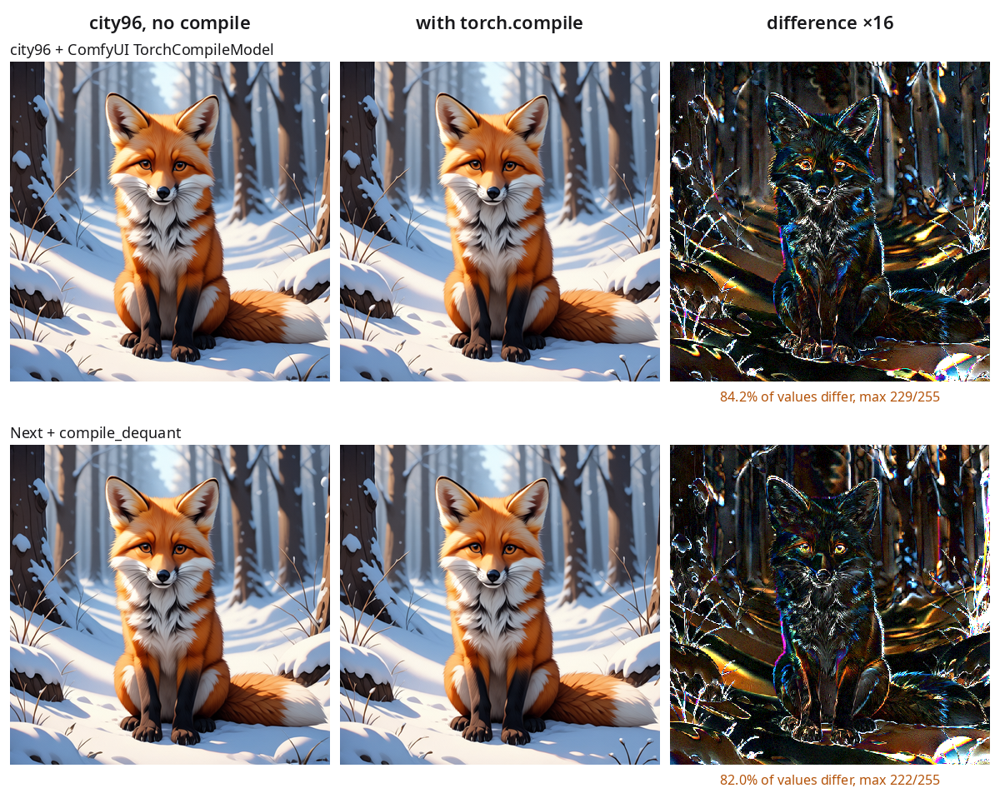

# Quant types and speed

**English** · [Русский](../quants.md)

## Types

Every kernel is checked bit for bit against the gguf-py reference with fp32 output (`tests/test_dequant.py`).

| Family | Types |
| --- | --- |
| Float / int | F32, F16, BF16, F64, I8, I16, I32, I64, F8_E4M3¹ |
| Legacy | Q4_0, Q4_1, Q5_0, Q5_1, Q8_0, Q1_0², Q2_0¹ |
| K-quants | Q2_K, Q3_K, Q4_K, Q5_K, Q6_K, Q8_K |
| I-quants | IQ1_S, IQ1_M, IQ2_XXS, IQ2_XS, IQ2_S, IQ3_XXS, IQ3_S, IQ4_NL, IQ4_XS |
| Ternary | TQ1_0, TQ2_0 |
| Microscaling FP4 | MXFP4², NVFP4² |

¹ needs gguf-py from llama.cpp master, not on PyPI yet. ² needs `gguf>=0.19`.

With an older `gguf` these types are just missing: such a file can't be read, everything else works. That is 35 types with master gguf-py and 33 with `gguf` 0.19.

Integer tensors (I8–I64) are never dequantized or cast to float. Quantized 1D tensors (norms, scalars from sd.cpp) are dequantized on load.

## Dequant speed

RTX 3050 Laptop, 4 GB, torch 2.11. One 3072×12288 weight (a Flux FFN layer) to fp16, median:

| Type | upstream | Next | Next + `compile_dequant` |
| --- | --- | --- | --- |
| Q8_0 | 1.5 ms | 1.5 ms | 0.9 ms |
| Q4_K | 4.5 ms | 4.5 ms | 0.8 ms |
| Q5_K | 6.3 ms | 6.3 ms | 0.9 ms |
| Q6_K | 6.3 ms | 6.3 ms | 2.8 ms |
| IQ4_XS | 6.9 ms | 6.9 ms | 0.7 ms |
| IQ3_S | 857 ms (numpy) | 10.3 ms | 1.5 ms |
| IQ2_XS | 638 ms (numpy) | 21.7 ms | 0.6 ms |
| IQ3_XXS | 735 ms (numpy) | 11.6 ms | 1.0 ms |

A full Anima 2B Q4_K_M step at a 64×64 latent (20 steps, averaged): 724 ms in upstream, 639 ms in Next. Peak VRAM for the whole run is 2.2 GiB in both, and the output is bit-identical.

The step gain comes from removing synchronous host→device copies inside dequantization. In a whole model, attention takes most of the time, so `compile_dequant` matters mostly for IQ and K quants and for small latents.

## compile_dequant

An option on Unet Loader (GGUF/Advanced), or the `GGUF_COMPILE_DEQUANT=1` variable. The dequant kernels are compiled with `torch.compile`.

- Needs a working `triton` (a C++ compiler on CPU).
- The first steps are slower while it compiles. On Anima the first run took about 15 seconds extra.
- fp32 output is bit-identical to the regular path for every type.
- fp16/bf16 values are rounded differently. Inductor keeps intermediates in fp32, so the compiled path is closer to fp32. On every one of the 510 quantized tensors of Anima Q4_K_M it is at least as close as the regular path:

| Type | output | regular path, max rel. error vs fp32 | compiled |
| --- | --- | --- | --- |
| Q4_K | fp16 | 2.2e-3 | 6.9e-4 |
| Q6_K | fp16 | 8.7e-4 | 5.0e-4 |
| Q4_K | bf16 | 2.7e-2 | 7.2e-3 |
| Q6_K | bf16 | 7.9e-3 | 5.2e-3 |

- On a few-step model such small differences change details of the image. ComfyUI's own TorchCompileModel does the same to city96/ComfyUI-GGUF. So an image made with `compile_dequant` is not bit-identical to upstream:

   
  Anima turbo, 6 steps. Top: city96 with TorchCompileModel. Bottom: GGUF-Next with compile_dequant. PSNR against no compile: 29.0 dB and 27.0 dB.

- A type that fails to compile quietly falls back to the regular path for good.
- It is one switch for the whole process. It works together with the TorchCompileModel node.
