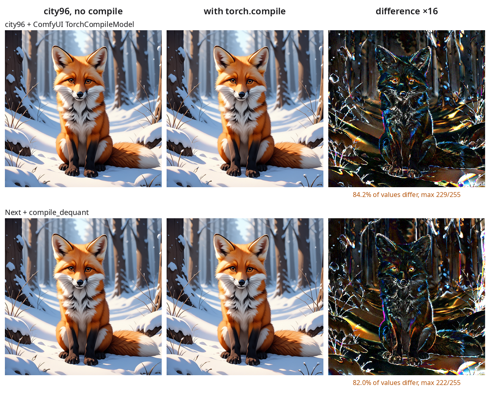

# Типы квантов и скорость

[English](en/quants.md) · **Русский**

## Типы

Каждое ядро сверено с эталоном gguf-py бит-в-бит при выходе в fp32 (`tests/test_dequant.py`).

| Семейство | Типы |
| --- | --- |
| Float / int | F32, F16, BF16, F64, I8, I16, I32, I64, F8_E4M3¹ |
| Legacy | Q4_0, Q4_1, Q5_0, Q5_1, Q8_0, Q1_0², Q2_0¹ |
| K-кванты | Q2_K, Q3_K, Q4_K, Q5_K, Q6_K, Q8_K |
| I-кванты | IQ1_S, IQ1_M, IQ2_XXS, IQ2_XS, IQ2_S, IQ3_XXS, IQ3_S, IQ4_NL, IQ4_XS |
| Троичные | TQ1_0, TQ2_0 |
| Microscaling FP4 | MXFP4², NVFP4² |

¹ нужен gguf-py из master llama.cpp, на PyPI его ещё нет. ² нужен `gguf>=0.19`.

Со старым `gguf` эти типы просто отсутствуют: такой файл не прочитать, остальное работает. Сейчас поддержано 35 типов с master gguf-py и 33 с `gguf` 0.19.

Целочисленные тензоры (I8–I64) не деквантуются и не приводятся к float. Квантованные 1D-тензоры (нормы, скаляры от sd.cpp) деквантуются при загрузке.

## Скорость деквантования

RTX 3050 Laptop, 4 ГБ, torch 2.11. Один вес 3072×12288 (FFN-слой Flux) в fp16, медиана:

| Тип | оригинал | Next | Next + `compile_dequant` |
| --- | --- | --- | --- |
| Q8_0 | 1.5 мс | 1.5 мс | 0.9 мс |
| Q4_K | 4.5 мс | 4.5 мс | 0.8 мс |
| Q5_K | 6.3 мс | 6.3 мс | 0.9 мс |
| Q6_K | 6.3 мс | 6.3 мс | 2.8 мс |
| IQ4_XS | 6.9 мс | 6.9 мс | 0.7 мс |
| IQ3_S | 857 мс (numpy) | 10.3 мс | 1.5 мс |
| IQ2_XS | 638 мс (numpy) | 21.7 мс | 0.6 мс |
| IQ3_XXS | 735 мс (numpy) | 11.6 мс | 1.0 мс |

Полный шаг Anima 2B Q4_K_M на латенте 64×64 (среднее по 20 шагам): 724 мс у оригинала, 639 мс у Next. Пиковая VRAM за прогон — 2.2 ГиБ в обоих случаях, выход совпадает бит-в-бит.

Выигрыш на шаге даёт отказ от синхронных копирований CPU→GPU внутри деквантования. В целой модели основное время уходит на attention, поэтому `compile_dequant` заметен в основном на IQ- и K-квантах и на маленьких латентах.

## compile_dequant

Опция в Unet Loader (GGUF/Advanced) или переменная `GGUF_COMPILE_DEQUANT=1`. Ядра деквантования компилируются через `torch.compile`.

- Нужен рабочий `triton` (на CPU — компилятор C++).
- Первые шаги медленнее: идёт компиляция. На Anima первый запуск занял около 15 секунд сверху.
- Выход в fp32 совпадает с обычным путём бит-в-бит для всех типов.
- Значения в fp16/bf16 округляются иначе. Inductor держит промежуточные значения в fp32, поэтому скомпилированный путь ближе к fp32. На каждом из 510 квантованных тензоров Anima Q4_K_M он не хуже обычного пути:

| Тип | выход | обычный путь, макс. отн. ошибка к fp32 | скомпилированный |
| --- | --- | --- | --- |
| Q4_K | fp16 | 2.2e-3 | 6.9e-4 |
| Q6_K | fp16 | 8.7e-4 | 5.0e-4 |
| Q4_K | bf16 | 2.7e-2 | 7.2e-3 |
| Q6_K | bf16 | 7.9e-3 | 5.2e-3 |

- На модели с малым числом шагов такие отличия меняют детали картинки. Штатный TorchCompileModel ComfyUI делает то же самое с city96/ComfyUI-GGUF. Поэтому картинка с `compile_dequant` не совпадает с оригиналом бит-в-бит:

   
  Anima turbo, 6 шагов. Сверху city96 с TorchCompileModel, снизу GGUF-Next с compile_dequant. PSNR относительно запуска без компиляции: 29.0 дБ и 27.0 дБ.

- Если тип не компилируется, он молча и навсегда переходит на обычный путь.
- Опция одна на весь процесс. Работает вместе с узлом TorchCompileModel.
